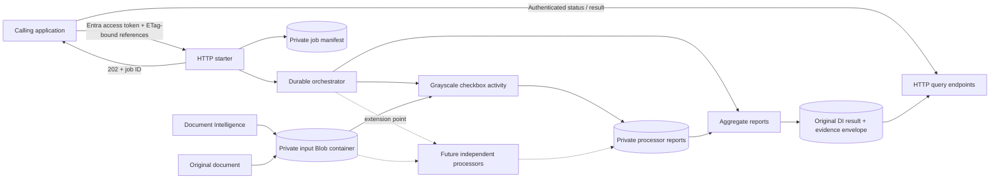

# Document Intelligence Post-processing

[](https://github.com/lcarli/document-intelligence-postprocessing/actions/workflows/ci.yml)
[](LICENSE)

**An extensible Azure Functions layer between document extraction and business decisions.**

Run independent post-processors against an existing Azure AI Document Intelligence
(DI) result. Preserve the original extraction, attach auditable evidence, and
route uncertain decisions to review instead of silently accepting them.

The first processor addresses a specific problem: **empty grayscale or halftone
checkboxes can look selected to an extraction model.** New validators can be
added as parallel activities without rewriting this processor.

> **Reference implementation, not a production certification.** This repository
> contains generic code and synthetic tests only. It does not contain customer
> documents, customer benchmark results, trained models, or environment settings.
> The Azure-hosted workflow must be validated in your own environment.

## Architecture



| Layer | Responsibility |
|---|---|
| HTTP API | Authenticate and authorize callers, validate references, submit jobs, enforce job ownership. |
| Durable Functions + Durable Task Scheduler | Recoverable fan-out/fan-in, activity scheduling, bounded retries. |
| Processor registry | Explicitly register versioned, independent processing methods. |
| Processor activities | Read immutable inputs, execute a method, persist its report. |
| Aggregator | Preserve the original DI JSON, collect reports, flag failures, review cases, and conflicts. |
| Blob Storage | Hold source inputs, private manifests, processor reports, and final results. |

The orchestrator does **not** receive document bytes, OCR text, field names,
checkbox scores, or arbitrary document URLs. Its history contains processor
identifiers, opaque job IDs, report references, and operational status.

**Why asynchronous?** The API returns `202 Accepted`; callers query status and
then retrieve the result. This supports additional parallel methods and recovery
without tying document processing to a single HTTP request. Durable scheduling,
Storage I/O, retries, and cold starts add overhead. Processor compute time is
**not** end-to-end API latency.

## What the grayscale verifier does

1. Locate page selection marks and nested custom fields of type `selectionMark`.
2. Render relevant PDF pages at **300 dpi**, or use native PNG/JPEG pixel resolution.
3. Convert each polygon's axis-aligned bounding crop to grayscale.
4. Apply Gaussian blur: `sigma = max(1.5, 0.07 * min(crop_width, crop_height))`.
5. Inspect the darkest blurred pixel in the **central 60%**, excluding a 20% margin
   on every side to reduce printed-border interference.
6. Suggest a state using configurable thresholds:

| Darkest pixel | Suggestion |
|---|---|
| `< 90` | `selected` |
| `> 150` | `unselected` |
| `90..150`, inclusive | `needs_review` |

This is **post-extraction verification**, not image cleanup. It never sends a
filtered document back to DI, calls DI, retrains a model, or changes the original
document. The score is a pixel intensity, **not a calibrated confidence probability**.

PDF polygons must use inches; image polygons must use pixels. Dimension mismatch,
invalid polygons, unknown original states, and missing/ambiguous geometry are
explicitly flagged. An unreadable or unsupported document fails the processor.
Transparent PNG backgrounds are composited on white.

### Modes

| Mode | Behavior |
|---|---|
| `off` | Do not load/render the document for this method. Preserve original states; record `not_run`. |
| **`shadow` (default)** | Compute suggestions and review flags, but keep `effective_state` equal to DI's original state. |
| `enforce` | Publish the verifier's suggestion as `effective_state`; uncertain results become `null` and require review. |

Even in `enforce`, **the original `analyze_result` is never modified**. Consumers
must deliberately adopt a processor's effective values. A shadow suggestion alone
is not permission to overwrite a business record. Set mode server-side, not in
the request.

### Important limitations

- A verifier cannot recover a checkbox that DI did not detect. Missing is not
  the same as unselected. If there are no detections at all, it flags review;
  it cannot infer an expected count without a separate business rule.
- Faint pencil marks, thick borders, small crops, overlapping text, and scan
  artifacts can remain ambiguous or produce errors. Calibrate against independent
  labeled data, including regressions, before enabling enforcement.
- Page marks and custom-field marks may describe the same physical checkbox.
  Reports preserve both with distinct JSON Pointer IDs; **do not count both as
  independent accuracy samples**.
- Multi-page PDF, single-page PNG, and single-page JPEG are supported. TIFF,
  password-protected PDFs, EXIF-rotated images, and other formats require upstream
  normalization or an explicit future adapter.
- Inputs must be from the same, unmodified document version. ETags prevent later
  mutation, but cannot prove that an upstream DI result belongs to a document.
- Parallel activities share the Function App's hosting resources. They are not
  separate security or CPU-isolation boundaries.

## Quickstart: no Azure account required

Use Python **3.12 or 3.13** on a platform supported by the native dependencies.
On Windows, use **x64 Python** if your architecture does not have OpenCV wheels.

```powershell
python -m venv .venv
.\.venv\Scripts\Activate.ps1
python -m pip install -r requirements-dev.txt
python .\examples\offline_demo.py
python -m pytest
```

The demo creates a synthetic form entirely in memory. Its three boxes produce
`unselected`, `selected`, and `needs_review`. In shadow mode, their original DI
states remain unchanged. No documents are uploaded and no Azure service is called.

## Integrate after DI

1. Save the **original document bytes** and the completed REST **`analyzeResult`
   object** in the configured private input container. Do not save the outer
   polling response as the analysis object.
2. Capture the exact, quoted ETag of each uploaded blob.
3. Submit their relative names and ETags with an authorized Entra v2 access token.
4. Poll the returned status path. Retrieve the result after runtime completion.
5. Check application `status` and `requires_review`, not just HTTP success or
   Durable's `Completed` runtime status.

The DI JSON alone is insufficient: the verifier needs the original page pixels.

```http
POST /api/v1/jobs
Authorization: Bearer <access-token>
Content-Type: application/json

{
  "document": {
    "name": "documents/synthetic-form.pdf",
    "etag": "\"0x8D0000000000001\""
  },
  "analysis": {
    "name": "analyses/synthetic-form.json",
    "etag": "\"0x8D0000000000002\""
  }
}
```

```json
{
  "job_id": "00000000-0000-4000-8000-000000000010",
  "status": "accepted",
  "status_path": "/api/v1/jobs/00000000-0000-4000-8000-000000000010",
  "result_path": "/api/v1/jobs/00000000-0000-4000-8000-000000000010/result"
}
```

The API never returns SAS URLs or Durable management URLs containing system keys.
Job status/results are bound to the submitting **tenant + caller app + object ID**.

See [the API contract](docs/api.md) for responses and result interpretation, and
[deployment and operations](docs/deployment.md) for authentication, private
networking, managed identity, required settings, and publishing.

## Add another processing method

Implement the small `Processor` protocol:

```python
from typing import Any

from postprocessing.models import (
    Finding,
    ProcessorReport,
    ProcessorSettings,
    ProcessorSpec,
)


class RequiredFieldProcessor:
    requires_document = False

    @property
    def spec(self) -> ProcessorSpec:
        return ProcessorSpec(name="required_fields", version="1.0.0")

    def process(
        self, document: bytes, analysis: dict[str, Any], settings: ProcessorSettings
    ) -> ProcessorReport:
        # Validate your own typed options and implement domain-specific rules here.
        return ProcessorReport(
            processor=self.spec,
            mode=settings.mode,
            status="completed",
            requires_review=False,
            findings=[Finding(code="example_rule_executed", severity="info")],
        )
```

This snippet illustrates the contract; **it does not implement required-field
validation**. A real method must implement off/shadow/enforce semantics, report
its parameters, and explicitly mark failed rules and uncertain decisions.

Then:

1. Add the processor instance to `processors()` in `postprocessing/registry.py`.
2. Add its **own** server-side `ProcessorSettings` entry to
   `Settings.processors` and the `settings()` factory in `postprocessing/config.py`.
   Put method-specific parameters in `options`, validated with your own Pydantic
   model. Settings must exactly match the registry; accidental omissions fail.
3. Add synthetic unit tests and a multi-processor orchestration test.
4. Increment the processor version when its decision semantics change.

The orchestrator automatically fans out to the registered methods. Each receives
its own configuration snapshot and report location. Methods with
`requires_document=False` do not download the source document.

There is deliberately **no last-writer-wins mutation of the DI result**. Reports
remain independent. Conflicting effective states for the same observation ID
flag `conflicting_targets` and force review. Semantic conflicts across different
field/page IDs need an explicit domain rule.

## Reliability, privacy, and operations

- Activity execution is **at least once**, not exactly once. Versioned report
  paths and create-only writes reuse the first committed result after retries.
  Repeated HTTP submissions intentionally create separate jobs.
- Inputs are read with `If-Match` ETag conditions. Changed, oversized, or
  inaccessible inputs are not silently replaced.
- Configuration, modes, limits, and processor versions are snapshotted per job.
  Application releases must preserve in-flight processor versions or drain jobs
  before switching to a new task hub/deployment.
- Document validation failures produce **failed reports**, not successful empty
  results. Transient storage failures trigger bounded activity retries.
  Control-plane integrity errors can fail the orchestration.
- Logs contain operational codes, processor IDs, and opaque job IDs, not document
  content, access tokens, or crop images. Dependency auto-tracking is disabled in
  `host.json`; govern platform/APIM logs and custom telemetry separately.
- Results and manifests are sensitive. Restrict input/output RBAC, configure
  retention and lifecycle rules, and avoid personal data in blob names.
- PDFium is used for PDF rendering to avoid making an AGPL-licensed renderer a
  dependency. PDFium calls are serialized within each Python worker because
  PDFium is not thread-safe. OpenCV/ROI work runs outside that lock.
- No diagnostic crops are persisted by default. Add any diagnostic export only
  with explicit data-handling controls.

## Project layout

```text
function_app.py                  HTTP routes, Durable bindings, activities
host.json                       Runtime, scheduler, concurrency, log settings
postprocessing/
  auth.py                       Entra signature/claims validation and owner binding
  config.py                     Validated server-side configuration
  analysis.py                   DI selection-mark discovery and JSON Pointer IDs
  imaging.py                    Bounded page rendering and coordinate validation
  models.py                     Typed request, report, and configuration contracts
  registry.py                   Explicit processor registration
  service.py                    Submission, input/output, reports, aggregation
  storage.py                    Managed-identity Blob adapter
  workflow.py                   Deterministic parallel orchestration
  processors/
    base.py                     Processor protocol
    grayscale.py                Gaussian checkbox verifier
examples/                       Synthetic demo and request
tests/                          Synthetic unit and mocked integration tests
docs/                           API and deployment/operations guides
```

## Development

```powershell
python -m ruff check .
python -m ruff format --check .
python -m mypy
python -m pytest --cov=postprocessing --cov=function_app --cov-report=term-missing --cov-fail-under=85
```

CI runs the same checks on Linux/Python 3.12 and 3.13, the offline demo, and
Function discovery. Tests use synthetic images/PDFs, real native image processing,
signed synthetic JWTs, and fake Storage/Durable clients. They **do not replace**
a real identity, network, scheduler, and load test in Azure.

Dependency manifests use bounded major versions. Resolve and review a
platform-specific lock/constraints file for your deployment pipeline and run
dependency/license scanning before production releases.

## References

- [Durable fan-out/fan-in](https://learn.microsoft.com/azure/durable-task/common/durable-task-fan-in-fan-out)
- [Durable Task Scheduler setup](https://learn.microsoft.com/azure/durable-task/scheduler/quickstart-durable-task-scheduler)
- [Azure Functions Python developer guide](https://learn.microsoft.com/azure/azure-functions/functions-reference-python)
- [Document Intelligence selection marks](https://learn.microsoft.com/azure/ai-services/document-intelligence/prebuilt/layout)

## License

[MIT](LICENSE). Third-party dependencies retain their own licenses. This
implementation offers no guarantee of extraction accuracy or suitability for
clinical, legal, or other high-impact decisions.
